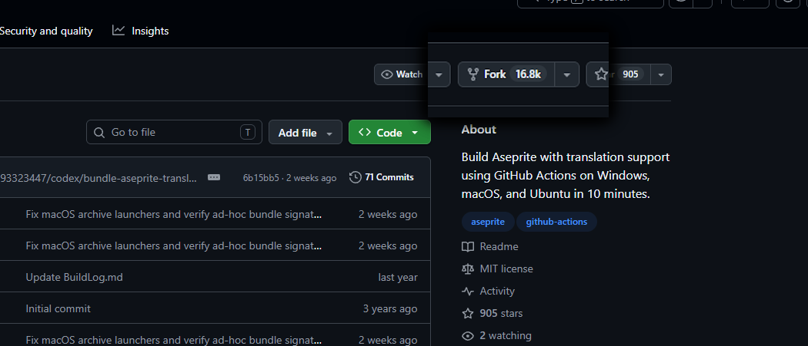
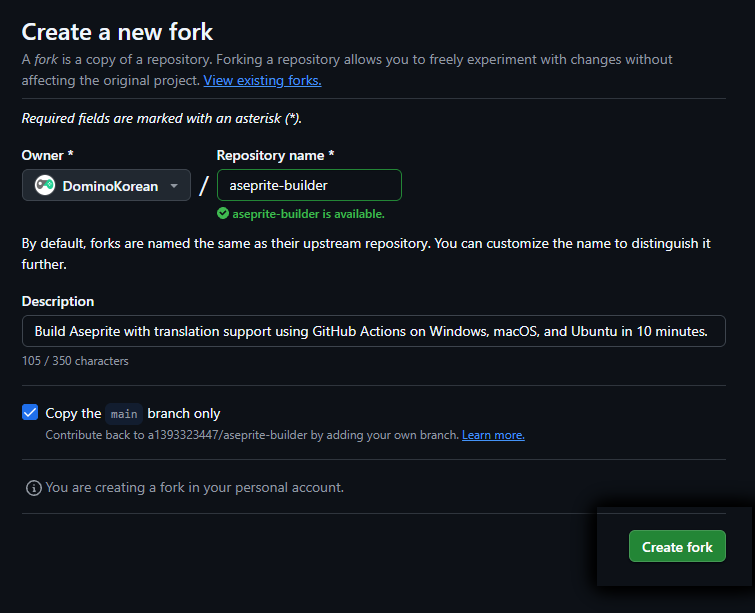
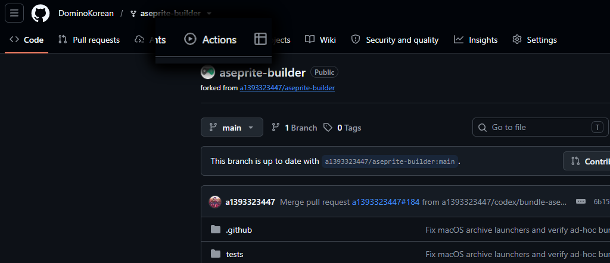
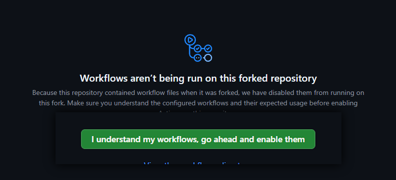
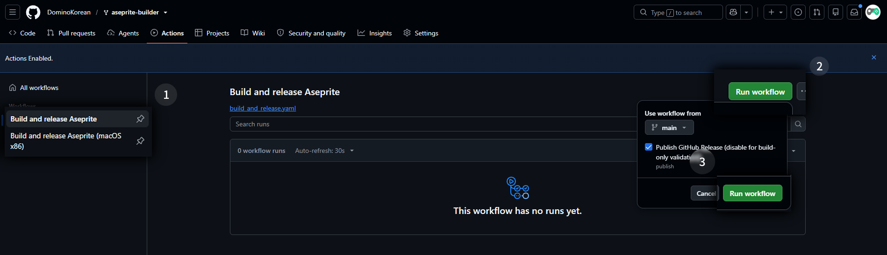
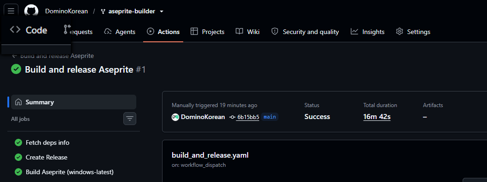
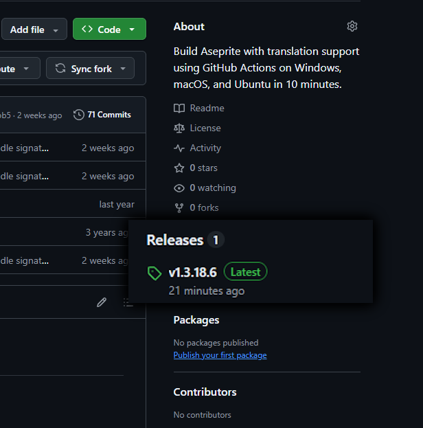

<ImageLightbox />

# Aseprite 무료 설치 방법

Aseprite는 유로 프로그램이지만 동시에 깃허브에 소스코드가 무료로 풀려있는 오픈소스 프로그램이다.
따라서 해당 소스코드를 직접 빌드하면 Aseprite를 무료로, 어떠한 법적 제약 없이 사용이 가능하다.

다만 이 프로그램을 빌드하는 과정은 필요한 패키지와 도구들을 설치해야한다는 점에서 약간의 번거움이 있다. 따라서 우리는 누가 미리 만들어놓은 Aseptrite를 빌드하는 깃허브 액션을 사용할 것이다.

하기 전에 깃허브 액션이 뭐냐 컴 해킹되는거 아니냐 라고 걱정할 수 있기 때문에 설명하자면, 깃허브 액션은 일종의 매크로다.  
앱을 자동으로 빌드해서 배포한다거나 하는 역할을 하는건데 여기서 중요한점은 이 **매크로가 깃허브의 컴퓨터에서 실행된다는 것**이다.
따라서 우리는 귀찮은 패키지 설치 / 블로그 글 보고 따라서 노가다 하기의 과정을 건너뛸 수 있다.

## 깃허브 빌더 사용 방법

하기 전에 먼저 깃허브 계정이 있어야 한다. 

 

1. **저장소를 내 계정으로 포크하기**

[저장소 링크](https://github.com/a1393323447/aseprite-builder)  

포크는 내 계정으로 저장소를 복제하는거라고 생각하면 편하다.  
내 계정에 저장소가 있어야 깃허브 액션 실행이 가능해진다.  
우측 위 `Create Fork`를 누르고, 우측 아래 `Create Fork`를 다시 한번 눌러주면 된다.

 

2. **깃허브 액션 실행**

내 계정으로 포크된 저장소에서 상단의 액션 탭으로 간다.

들어가면 중앙에 나오는 녹색 버튼을 눌러준다.  
참고로 내용은 외부 프로그램 실행 전 흔한 주의 문구이다.  
여기서 걱정된다면 만약 보안위험이 있었다면 유명한 저장소인 만큼 진작에 내려갔거나 소문났을 터이니 안심하고 써도 좋다.

이후 아래 사진을 따라
1. `Build and release Aseprite` 선택
만약 MacOS x86일 경우 아래에 있는것 선택. 일반 MacOS는 위에걸로 하면 된다.
2. 우측 `Run workflow` 클릭
3. 클릭하면 나오는 곳에 녹색 `Run workflow` 클릭

순으로 하면 된다.

다 하게 되면 액션이 작동하기 시작하는데, 주황색 돌아가는 동그라미가 다 녹색 원으로 바뀔때까지 기다리면 된다.  
대략 17분정도 걸린다.

 

3. **다운로드 및 설치**

다 됐다면 상단에서 Code 탭으로 돌아간다.

돌아가면 우측에 Release에 무언가 생겨있는데 눌러서 들어가면 된다.
참고로 화면 세로가 좁으면 Release가 하단에 배치된다.

들어가면 zip가 총 3개가 있는데 여기서 각자 컴퓨터 플랫폼 맞춰서 다운로드해 사용하면 된다.
