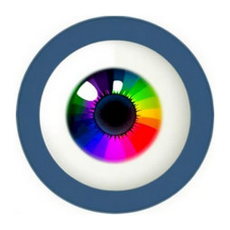
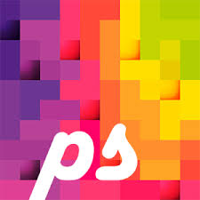
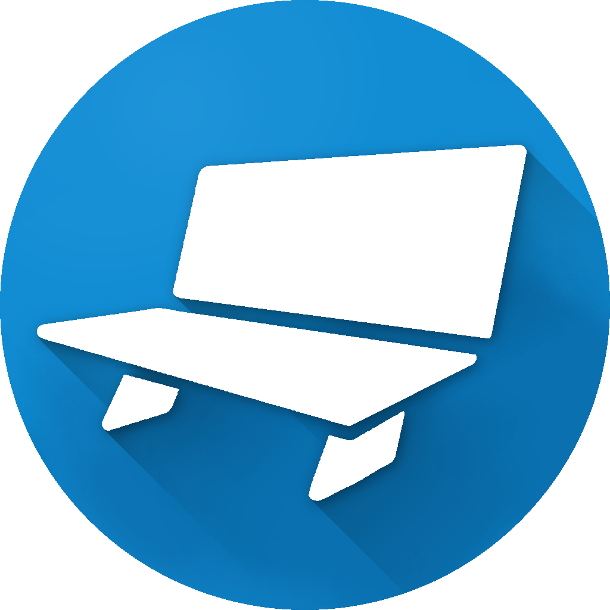
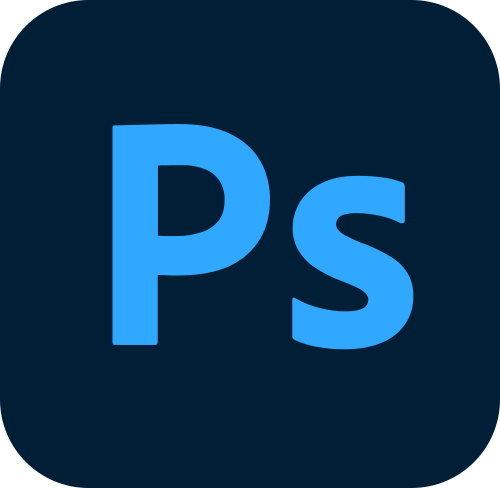
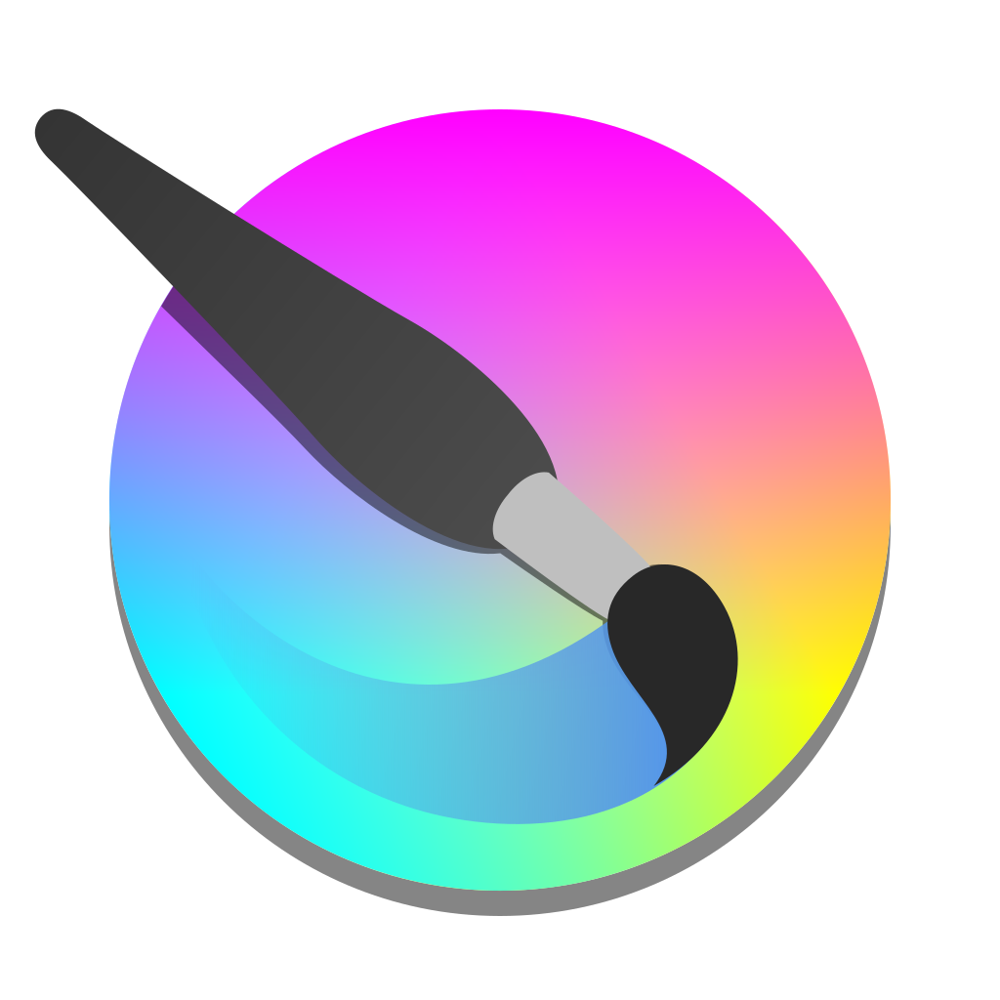
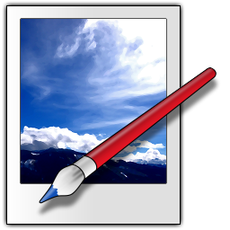
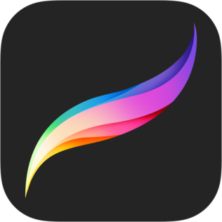
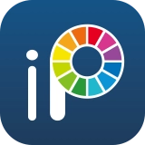

# 픽셀아트 프로그램 목록

::: info :bulb: **오픈소스**에 대해서
다운로드 링크 옆에 `오픈소스`로 표시돼 있는 건 소스코드는 다 무료로 열려있는데 패키징 배포가 무료로 거기에 안돼있다는 말임  
Aseprite 같이 유명한 건 검색하면 하는 방법 나옴
:::

::: info :bulb: OS 설명
- 아이폰 - **iOS**
- 아이패드 - **iPadOS**
- 그 외 모든 휴대기기 - **Android**
:::

## Aseprite {#aseprite}

**PC** &nbsp; `Windows` `Mac` `Linux`  

> **현업에서 많이 실사용됨**  

> 드로잉, 에니메이팅, 플러그인 지원, 한국어 유저번역 지원  
> 타일셋, 9-slice, JSON 내보내기 관련 세부 요소 지원

- [Github](https://github.com/aseprite/aseprite) &nbsp; `오픈소스`
- [Steam](https://store.steampowered.com/app/431730/Aseprite) &nbsp; `₩ 20,500`
- [itch.io](https://dacap.itch.io/aseprite) &nbsp; `$ 19.99 USD`

> https://www.aseprite.org

현업에서 포토샵 다음으로 가장 많이 사용되는 프로그램. 많은 기능, 다양한 자료와 플러그인 생태계가 큰 장점.  
깃허브에서 소스코드를 빌드할 시 무료로 사용 가능. 스팀에서 구매할 시 버전 업데이트가 자동이라는 장점이 있음.

## Pixquare {#pixquare}

**PC, 모바일** &nbsp; `Mac` `iOS` `iPadOS`  

> **많이 실사용됨**  

> 드로잉, 에니메이팅, 한국어 기계번역 지원  
> aseprite 애니메이션 태그 지원

- [Apple App Store](https://apps.apple.com/us/app/pixquare-pixel-art-studio/id1659428179)  
    `모든 기기 ₩ 29,000` `iPad ₩ 25,000` `iPhone ₩ 11,000`

> https://www.pixquare.art

아이패드에서 사용 가능한 가장 괜찮은 프로그램. 1인 인디 개발이기 때문에 구형 기기에서는 일부 오류가 날 수 있음.  
기능이 비교적 적지만 UI가 깔끔해 쓰기 좋은것이 특징.

## Resptire {#resprite}

Resprite: **PC, 모바일** &nbsp; `Mac` `iOS` `iPadOS`   
Resprite DA: **PC, 모바일** &nbsp; `Windows` `Mac` `Android`

> **Android 에서 많이 실사용됨**  

> 드로잉, 에니메이팅, 한국어 기계번역 지원  
> aseprite 애니메이션 태그 지원, 타일셋 관련 지원

- Resprite
  - [Apple App Store](https://apps.apple.com/us/app/resprite-pixel-art-studio/id1662335989)  
    `한달 ₩ 3,300` `12개월 ₩ 19,000` `영구구매 ₩ 33,000`
- Resprite DA
  - [Steam](https://store.steampowered.com/app/3146020/Resprite/) `&nbsp; ₩ 21,500`
  - [Google Play](https://play.google.com/store/apps/details?id=com.fengeon.resprite_desktop)  
  `한달 ₩ 3,300` `12개월 ₩ 16,000` `영구구매 ₩ 33,000`

> https://resprite.fengeon.com

아이패드에서 사용 가능한 가장 괜찮은 프로그램. 매우 다양한 기능과 중국 1인 개발자가 개발하는 덕에 오류 없는 CJK지원이 장점.  
타일셋관련 지원이 잘돼있어 태블릿에서 게임 스프라이트 작업용 앱을 찾고 있다면 추천.  
태블릿과 PC 사이를 연계해서 작업하고 싶은게 아니라면 비효율적인 UI배치, 멋대로인 단축키로 PC에서 사용하는것은 비추천.

## Pro Motion NG {#pro-motion-ng}

**PC** &nbsp; `Windows`   

> **현업에서 많이 실사용됨**  

> 드로잉, 에니메이팅

- [공식 홈페이지 라이선스 키 구매](https://www.cosmigo.com/pixel_animation_software/buy) &nbsp; `$ 19.00`
- [Steam](https://store.steampowered.com/app/671190/Pro_Motion_NG/) &nbsp; `₩ 27,000`

> https://www.cosmigo.com

## Edge3 {#edge3}

**PC** &nbsp; `Windows`   

> 드로잉, 에니메이팅, 한국어 공식 지원  
> aseprite 애니메이션 태그 지원, json 내보내기및 타일셋 기능 일부 지원

- [Steam](https://store.steampowered.com/app/4593020/Edge3/) &nbsp; `₩ 21,000`

> https://edge3.takabosoft.com

개인 인디/소규모 스튜디오및 서양쪽에서 제작되는 프로그램인것과 달리 일본 소규모 회사에서 작업하기 때문에
깨지지 않고 제대로 움직이는 UI및 여러 요소들, 매끄러운 기능등 사용성이 현대적인 디자인프로그램에 가까운것이 특징.
Aseprite의 깨지는 화면, 불편한 UI가 싫다면 추천.
아직 얼리억세스이기 때문에 문서화가 전부 돼있지 않고 기능 추가 건의 시 피드백이 잘 들어감.

## LibreSprite {#libresprite}

**PC** &nbsp; `Web` `Windows` `Mac` `Linux`  

> 드로잉, 에니메이팅, 플러그인 지원, 한국어 유저번역 지원  

- [공식 홈페이지](https://libresprite.github.io/#!/downloads) &nbsp; `무료`
- [웹 버전](https://libresprite.github.io/#!/downloads)
- [Github](https://github.com/LibreSprite/LibreSprite)

> https://libresprite.github.io

Aseprite가 아직 GPLv2 라이선스일때 포크된 무료 프로그램.  
Aseprite와 달리 레이어 그룹 없음, 타일맵 레이어 없음, json 내보내기 일부 미지원, 플러그인 미호환.
대신 웹버전을 지원함.
전문적인 장기 작업외에 간단한 작업만 무료 프로그램으로 하고 싶다면 Aseptrite를 대신해서 추천. 

## SqPaint {#sqpaint}

**PC** &nbsp; `Windows`

> 드로잉, 일본어만 지원

> https://nezutako.com/works/tools/sq-paint

## voidsprite {#voidsprite}

**PC** &nbsp; `Windows`

> 드로잉
> 타일셋 일부 지원, 실시간 협업 지원

- [itch.io](https://cntrpl.itch.io/voidsprite) &nbsp; `무료`
- [Github](https://github.com/counter185/voidsprite)

## Pixel Studio {#pixel-studio}

**PC, 모바일** &nbsp; `Windows` `Mac` `Android` `iOS` `iPadOS`

> 드로잉, 에니메이팅, 한국어 일부 지원

- [Steam](https://store.steampowered.com/app/1204050/Pixel_Studio__pixel_art_editor/) &nbsp; `무료`
- [Microsoft Store](https://apps.microsoft.com/detail/9p7xs7vh1r3j?hl=en-US&gl=US) &nbsp; `무료`
- Google Play
  - [Pixel Studio](https://play.google.com/store/apps/details?id=com.PixelStudio) `무료`
  - [Pixel Studio PRO ](https://play.google.com/store/apps/details?id=com.pixelstudio.pro) `₩ 8,900`
- Apple App Store
  - [Pixel Studio](https://apps.apple.com/us/app/pixel-studio-for-pixel-art/id1404203859) `무료`
  - [Pixel Studio PRO ](https://apps.apple.com/us/app/pixel-studio-pro-for-pixel-art/id1476932307) `₩ 19,000`
- [Mac App Store](https://apps.apple.com/us/app/pixel-studio-for-pixel-art/id1477015249?mt=12) `무료`

## PixiEditor {#pixieditor}

**PC** &nbsp; `Windows` `Linux` `Mac`

> 드로잉, 에니메이팅, 노드 컴포지팅, 벡터 드로잉

- [공식 홈페이지](https://pixieditor.net/download) &nbsp; `무료`
- [Github](https://github.com/PixiEditor/PixiEditor)
- [Steam](https://store.steampowered.com/app/2218560/PixiEditor/) &nbsp; `무료`
- [itch.io](https://pixieditor.itch.io/pixieditor) &nbsp; `무료`

> https://pixieditor.net

## Pixelorama {#pixelorama}

**PC** &nbsp; `Web` `Windows` `Linux` `Mac`

> 드로잉, 에니메이팅, 3D 렌더링,  한국어 유저번역 지원

- [Github](https://github.com/Orama-Interactive/Pixelorama/releases) &nbsp; `무료`
- [Steam](https://store.steampowered.com/app/2779170/Pixelorama/) &nbsp; `₩ 11,000`
- [itch.io](https://orama-interactive.itch.io/pixelorama) &nbsp; `무료`
- [Flathub](https://flathub.org/en/apps/com.orama_interactive.Pixelorama) &nbsp; `무료`

> https://pixelorama.org

## Blockbench[* 모델링 툴이지만 픽셀아트 워크스페이스를 지원함]  {#blockbench}

**PC** &nbsp; `Web`[* 모바일 UI지원 ] `Windows` `Linux` `Mac`

> 드로잉, 한국어 유저번역 지원
> 실시간 협업 지원

- [Blockbech](https://www.blockbench.net/downloads) &nbsp; `무료`
- [Blockbech (Web)](https://web.blockbench.net/)

> https://www.blockbench.net

## Novaboard {#novaboard}

**PC** &nbsp; `Web`

> 드로잉, 에니메이팅

- [itch.io](https://marcel0ll.itch.io/novaboard) `무료`

> https://novaboard.app/

 
 

---

 
 
 

# 픽셀아트에 사용이 가능한 프로그램 목록

::: info :bulb: 픽셀아트가 가능한 프로그램 목록
픽셀아트 전용 프로그램은 아니지만 실제로 픽셀아트에 사용돼는 프로그램 목록

"현업에서 많이 사용됨"은 픽셀아트 기준
:::

## Adobe Photohop {#photoshop}

**PC, 모바일** &nbsp; `Windows` `Mac` `Android` `iOS` `iPadOS`

> **현업에서 많이 실사용됨**

> 드로잉, 에니메이팅, 플러그인 지원, 한국어 지원

> https://www.adobe.com/kr/products/photoshop.html

가장 많이 업계에서 사용되고 사용됐던 툴.  
픽셀아트만 보고 구매하는것은 가격 때문에 비추천. 특히나 애니메이팅 툴 구현에는 한계가 있음.

## Krita {#krita}

**PC, 모바일** &nbsp; `Windows` `Mac` `Linux` `Android` `iOS` `iPadOS`

> 드로잉, 에니메이팅, 플러그인 지원, 한국어 유저번역 지원

- [공식 홈페이지](https://krita.org/ko/download/) &nbsp; `무료`
- [Github](https://github.com/KDE/krita) &nbsp; `오픈소스`
- [Steam](https://store.steampowered.com/app/280680/Krita/) &nbsp; `₩ 11,000`
- [Epic Games Store](https://store.epicgames.com/ko/p/krita) &nbsp; `₩ 10,000`
- [Microsoft Store](https://apps.microsoft.com/detail/9n6x57zgrw96?hl=en-US&gl=US) &nbsp; `$ 14.99`
- [Mac App Store](https://apps.apple.com/us/app/krita/id1594607976?mt=12) &nbsp; `$ 12.99`

> https://krita.org

플러그인 넓은 방면으로 지원, 공식적으로 애니메이팅 지원, 실시간 타일링 지원 덕분에
픽셀아트 전용 프로그램이 아님/여러 플랫폼 지원/무료 프로그램 중에서 가장 쓸만함 

## Clip Studio {#clip-studio}

**PC, 모바일** &nbsp; `Windows` `Mac` `Android` `iOS` `iPadOS`

> 드로잉, 에니메이팅, 플러그인 지원, 한국어 지원

> https://www.clipstudio.net

## Paint.NET {#paintnet}

**PC** &nbsp; `Windows` `Mac` `Linux` `Android` `iOS` `iPadOS`

> 드로잉, 플러그인 지원, 한국어 지원

- [공식 홈페이지](https://www.getpaint.net/download.html) &nbsp; `무료`
- [Github Release](https://github.com/paintdotnet/release/releases) &nbsp; `무료`
- [Microsoft Store](https://apps.microsoft.com/detail/9nbhcs1lx4r0?hl=ko-KR&gl=KR) &nbsp; `₩ 18,900`

> https://www.getpaint.net

## Procreate {#procreate}

**모바일** &nbsp; `iPadOS`

> 드로잉, 한국어 지원

- [Apple App Store](https://apps.apple.com/us/app/procreate/id425073498) &nbsp; `₩ 19,000`

> https://procreate.com

픽셀아트 드로잉이 가능하다 정도에만 의의를 두는게 좋음.

## Ibis Paint {#ibis-paint}

**PC, 모바일** &nbsp; `Windows` `Mac` `Android` `iOS` `iPadOS`

> 드로잉, 한국어 지원

- [Google Play](https://play.google.com/store/apps/details?id=jp.ne.ibis.ibispaintx.app)
- [HUAWEI AppGallery](https://appgallery.cloud.huawei.com/ag/n/app/C101937815?channelId=ibis+Paint+X&id=1aca11bdc8c04e02b448b7041ad23458&s=7DCDF1D53C5F00D7B84370F01893FC42642EB17DF997B04B84F24C8B7692023C&detailType=0&v=)
- [Apple App Store](https://itunes.apple.com/kr/app/id450722833?mt=8)
- [Microsoft Store](https://www.microsoft.com/store/apps/9PFDF2ZD4Z4N)
- [Mac App Store](https://apps.apple.com/us/app/ibispaint-your-art-studio/id6737590363)

::: info 🧾 가격
플랫폼별 차이 있음
:::

> https://ibispaint.com

픽셀아트 드로잉이 가능하다 정도에만 의의를 두는게 좋음.
만약 애니메이션, 타일링같은 복잡한걸 안하고 완전히 휴대폰 화면, 또는 기기가 조금 저사양이라면 매우 추천.

