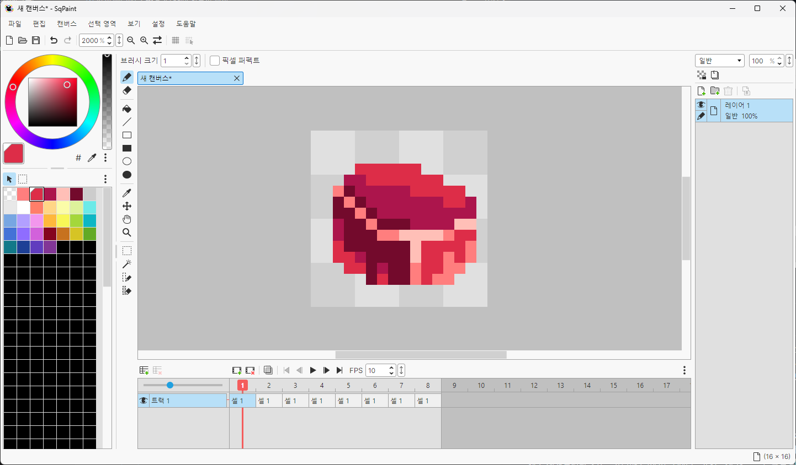

# SqPaint 한국어 패치 사용법

## SqPaint 란?
SqPaint는 일본의 1인 개발자가 개발하는 무료 인디 픽셀아트 프로그램으로,  
인덱스 기반 컬러링, 가벼운 프로그램, 깔끔한 UI가 특징인 프로그램이다.

- [SqPaint 다운로드](https://nezutako.com/works/tools/sq-paint/)

## 사용법
1. [이 링크에서 패치 파일 다운로드](https://github.com/DominoKorean/sq-paint-ko/archive/refs/heads/main.zip)
2. zip 압축 풀고 안에 Apply-Korean.cmd를 실행한 후 SqPaint의 폴더(exe 파일이 들어있는 폴더)를 선택
3. 선택했던 폴더에서 새로 생긴 SqPaint-Korean.cmd를 실행하면 한국어 패치 파일이 열린다.

 
 

---

- [수정 사항및 오역 문의/건의](https://github.com/DominoKorean/sq-paint-ko)
- [번역 깃허브 저장소](https://github.com/DominoKorean/sq-paint-ko)