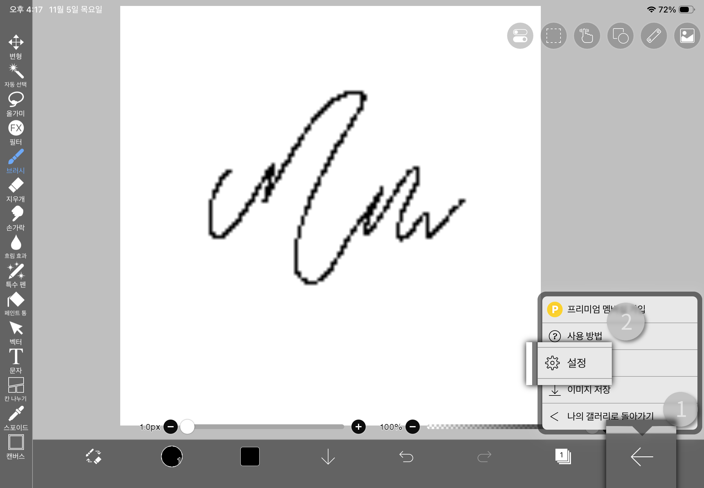
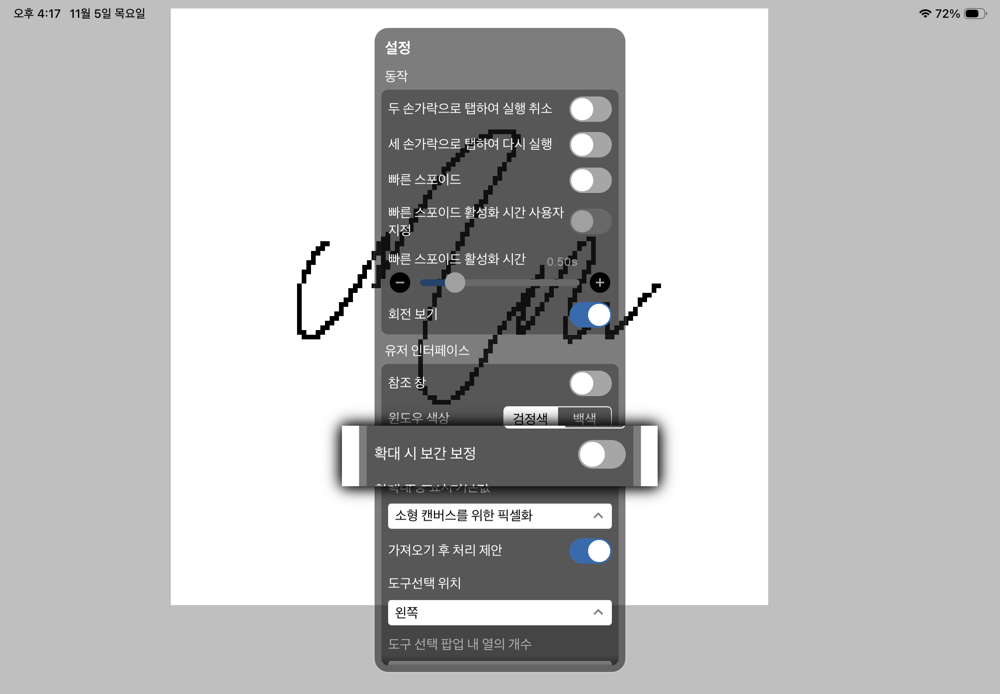
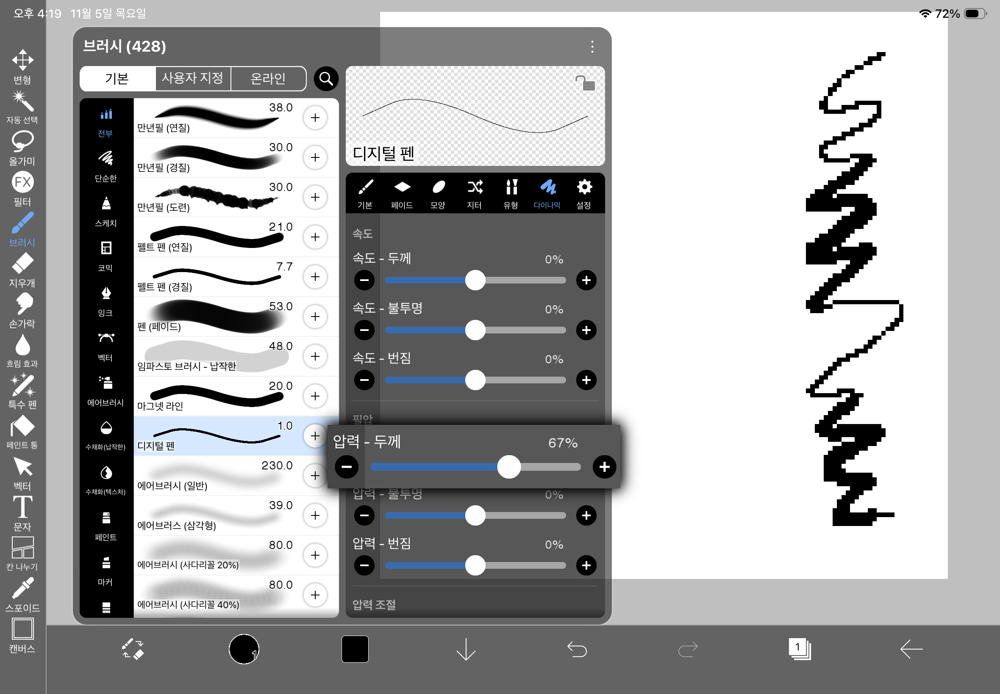
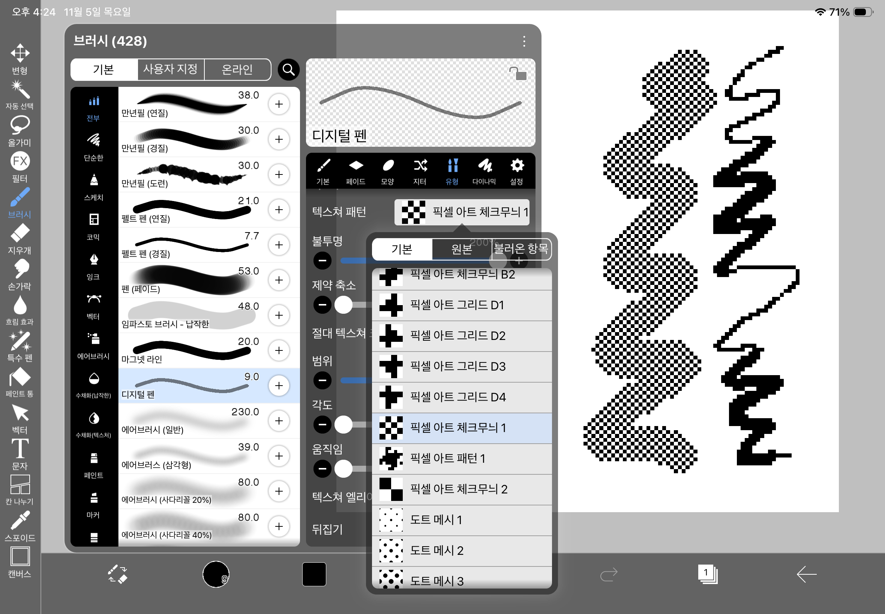
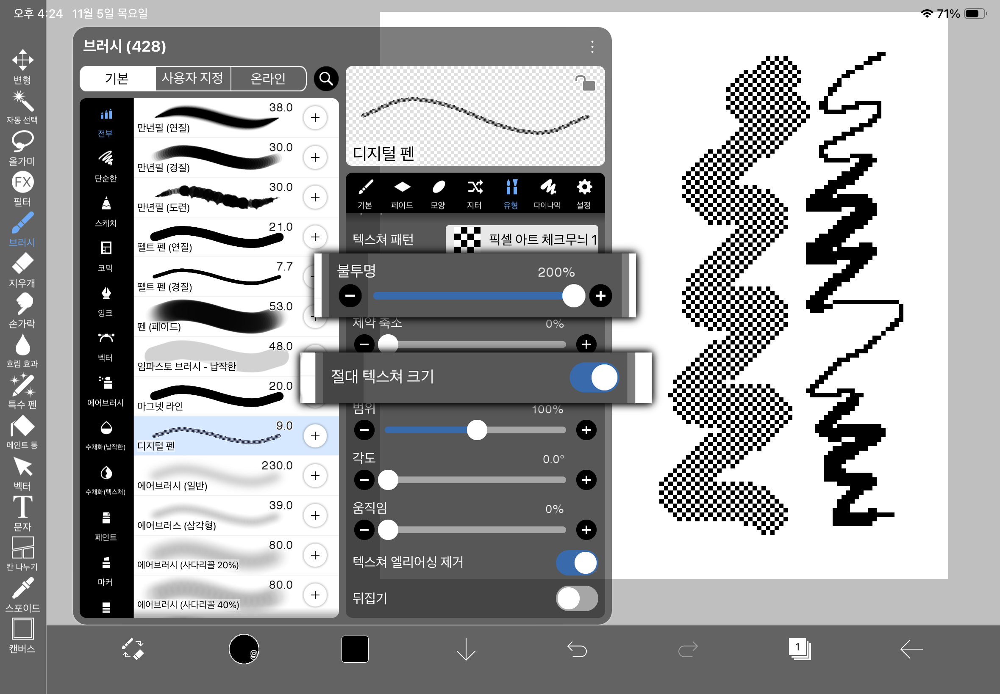

<ImageLightbox />

# Ibis Paint에서 픽셀 아트 하는 법

## Ibis Paint에서 픽셀 아트를 할 만할까?

- 애니메이션 작업은 힘들더라도 기본적으로 많이 쓰이는 드로잉 프로그램이기 때문에 있을 도구는 다 있음
- 최적화가 좋음
- 무료
- 완전히 모바일에서도 사용 가능

이 때문에 태블릿/폰에서 가볍게 드로잉할 무료 앱을 찾는다면 좋은 선택지다.

## 캔버스 생성하기

캔버스는 일반적으로 게임 스프라이트 등에선 16x16, 128x128 같이 2의 거듭제곱수로 하나,  
자유로운 드로잉의 경우라면 원하는 대로 해도 큰 상관은 없다.

## 캔버스 흐릿하게 안 보이게 하는 법

픽셀 아트를 할 수 있을 정도로 해상도를 낮출 경우 픽셀이 뿌옇게 보이는데 이는 화질이 안 깨져 보이고 계단 현상을 없애는 **안티에일리어싱**효과 때문이다.  
보통 포토샵이나 클립 스튜디오같이 화면을 일정 이상 확대하면 자동으로 적용을 안 하고 보여주는 경우가 있으나, Ibis Paint에선 그런 게 없기 때문에 직접 꺼줘야 한다.

아래 사진과 같이 우측 하단 ← 탭의 설정으로 들어간 후

많이 내려갈 필요 없이 "유저 인터페이스"에서 **확대 시 보간 보정**을 꺼주면 픽셀이 선명하게 잘 보인다.

## 픽셀 아트에 쓸 브러시 세팅법

브러시는 따로 세팅할 필요 없이 기본 브러시 중 안티에일리어싱이 적용되지 않은 **디지털 브러시**를 사용하면 된다.  
기본 브러시 중 상단에 위치해 있으며, 브러시 종류 중 디지털 쪽에서도 맨 상단에서 찾을 수 있다.

만약 필압을 쓰고 싶을 경우 펜설정의 다이나믹 쪽에서 압력 - 두께를 + 쪽으로 증가시키면 된다.  
만약 너무 꽉 눌러야 두께가 변경된다거나 반대로 살짝만 눌러도 빠르게 두꺼워진다면 아래 압력 조절 쪽의 굵기의 그래프를 조절해 주면 된다.

만약 디더링 브러시를 사용하고 싶을 경우 유형 - 텍스처 패턴에서  
픽셀 아트라는 이름이 붙여진 패턴을 고른 뒤

불투명을 100% 이상,
**절대 텍스쳐 크기**를 켜주면 된다.

필압/불투명에 따라 디더링 강도를 조절할 수는 없고 대신 Ibis Paint의 커스텀 텍스처 패턴에서 디더링을 단계별로 저장해 둘 수는 있다.

만약 직접 제작하기 귀찮을 경우 미리 준비된 단계별 디더링 브러시를 사용해도 된다.
- [Ibis Paint 픽셀 아트 디더링 브러시](./brush/)
